# Schermen – Restje

Ontwerp van alle schermen van de app, volgens de Must-vereisten uit de opgave.
De afbeeldingen staan in [`docs/schermen/`](docs/schermen/).

## Inhoud

1. [Account](#account)
2. [Klant](#klant)
3. [Handelaar](#handelaar)
4. [Locatie-toestemming](#locatie-toestemming)
5. [Meldingen en laden](#meldingen-en-laden)
6. [Huisstijl](#huisstijl)
7. [Overzicht vereisten](#overzicht-vereisten)

---

## Account

<table>
  <tr>
    <th>Inloggen</th>
    <th>Registreren</th>
  </tr>
  <tr>
    <td>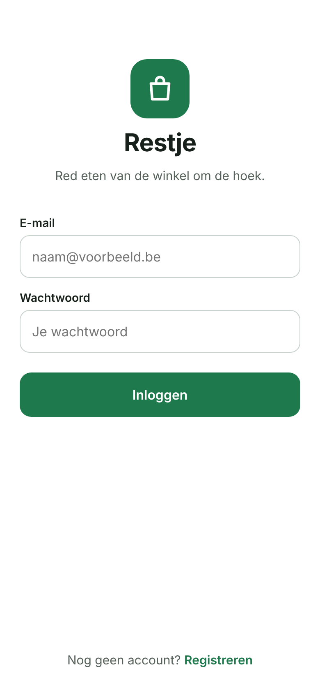</td>
    <td>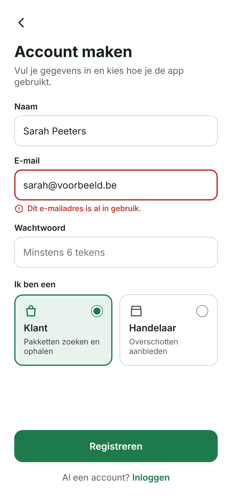</td>
  </tr>
  <tr>
    <td>A2, A3 E-mail en wachtwoord. Na inloggen naar het startscherm van je rol.</td>
    <td>A1, A3 Naam, e-mail, wachtwoord en rolkeuze. Toont een voorbeeld van een foutmelding.</td>
  </tr>
</table>

---

## Klant

De klant heeft een navigatiebalk onderaan met de tabs **Ontdekken**, **Kaart**, **Bestellingen** en **Favorieten**.

<table>
  <tr>
    <th>Ontdekken</th>
    <th>Kaart</th>
    <th>Pakketdetail</th>
  </tr>
  <tr>
    <td>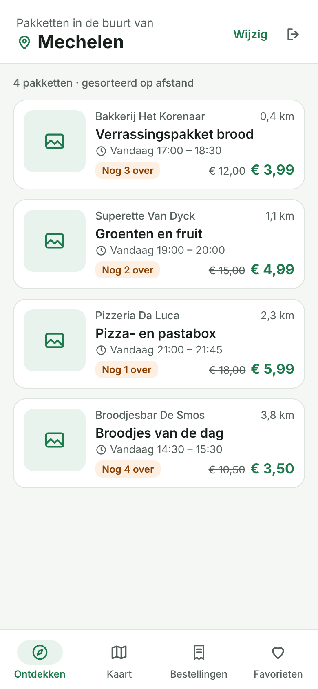</td>
    <td>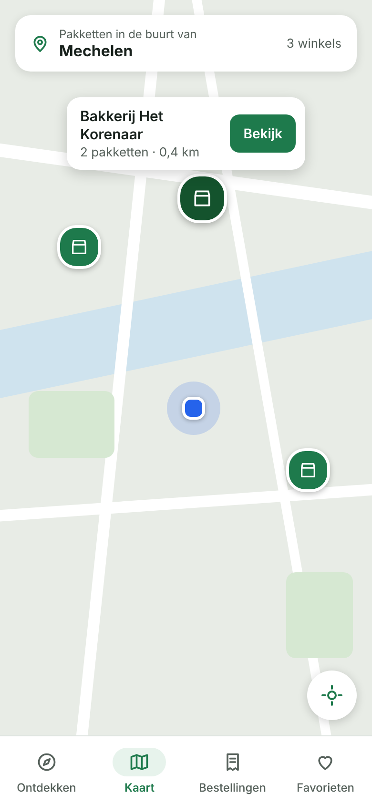</td>
    <td>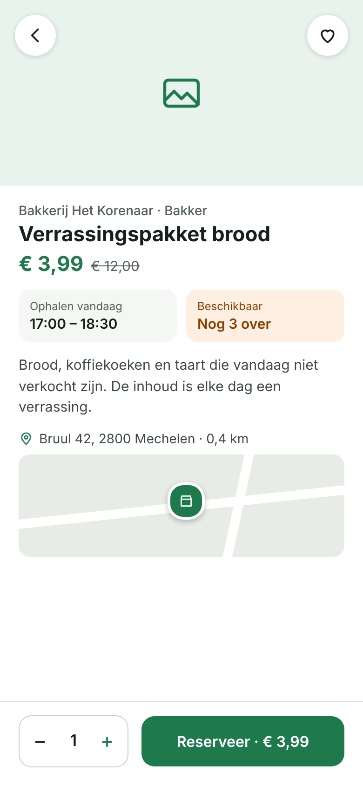</td>
  </tr>
  <tr>
    <td>K2, K3, K5, A2 "Pakketten in de buurt van {gemeente}", lijst gesorteerd op afstand, uitlogknop.</td>
    <td>K4, K5 OSMDroid-kaart met eigen locatie, winkelmarkers en popup met "Bekijk".</td>
    <td>K7, K8, K12 Foto, info, kleine kaart, aantal kiezen, "Reserveer" en hartje voor favoriet.</td>
  </tr>
  <tr>
    <th>Bestellingen</th>
    <th>Favorieten</th>
    <th></th>
  </tr>
  <tr>
    <td>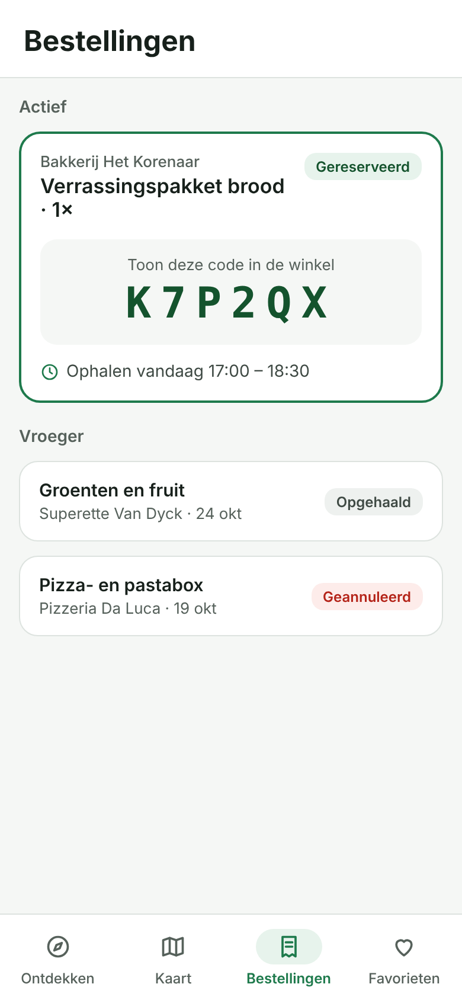</td>
    <td>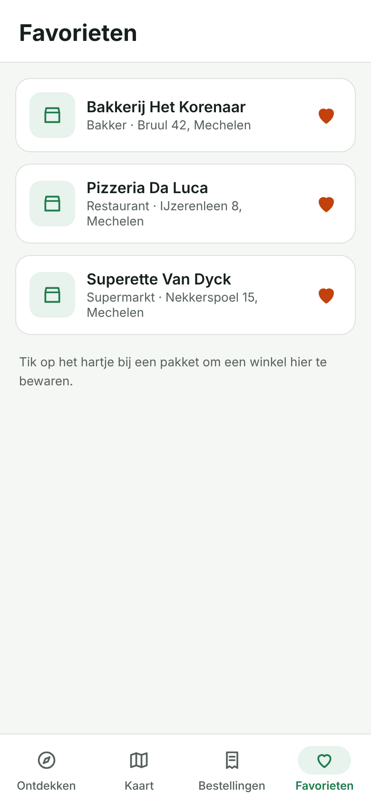</td>
    <td></td>
  </tr>
  <tr>
    <td>K9, K10 Ophaalcode en status. Leest enkel uit Room, dus werkt ook offline.</td>
    <td>K12 Favoriete winkels, lokaal bewaard in Room.</td>
    <td></td>
  </tr>
</table>

---

## Handelaar

De handelaar heeft een navigatiebalk onderaan met de tabs **Mijn winkel** en **Mijn pakketten**.

<table>
  <tr>
    <th>Mijn winkel</th>
    <th>Mijn pakketten</th>
    <th>Pakket aanmaken</th>
  </tr>
  <tr>
    <td>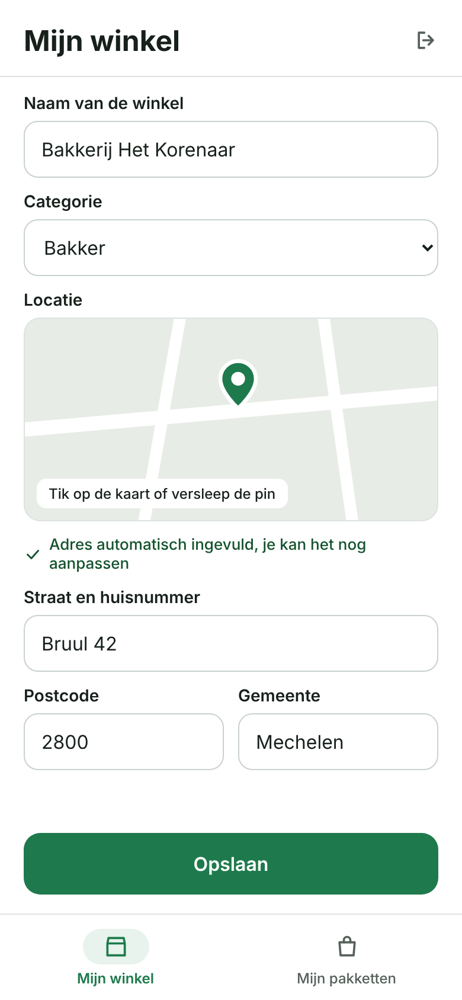</td>
    <td>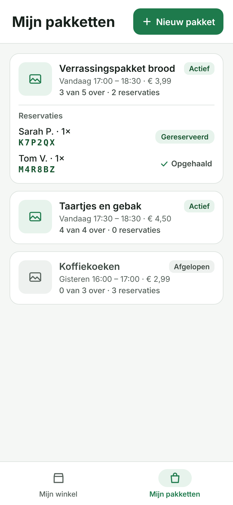</td>
    <td>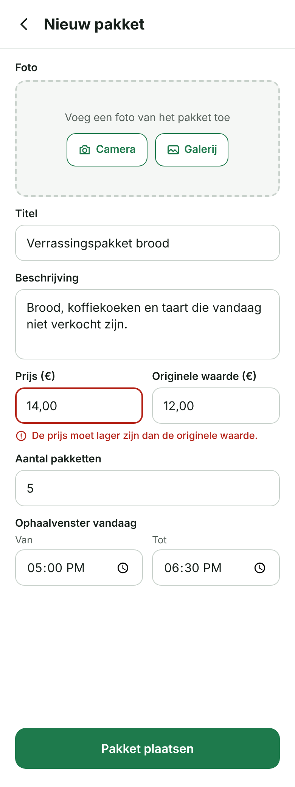</td>
  </tr>
  <tr>
    <td>H1, H2, A2 Pin op de kaart, adres automatisch ingevuld via Nominatim, uitlogknop.</td>
    <td>H5 Eigen pakketten met het aantal reservaties, realtime bijgewerkt.</td>
    <td>H3, H4, G1 Formulier met foto (camera of galerij) en een voorbeeld van een validatiefout.</td>
  </tr>
</table>

---

## Locatie-toestemming

Alle gevallen uit K1 en de technische vereiste "Permissies".

<table>
  <tr>
    <th>Uitleg vóór de vraag</th>
    <th>Geweigerd: locatie kiezen</th>
  </tr>
  <tr>
    <td>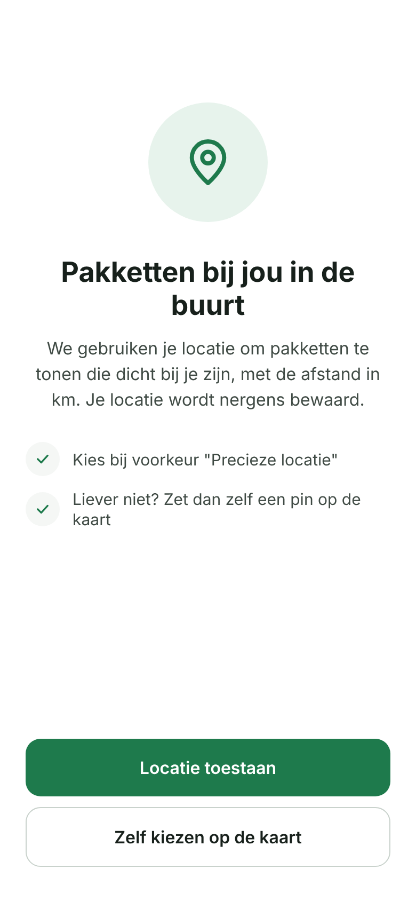</td>
    <td>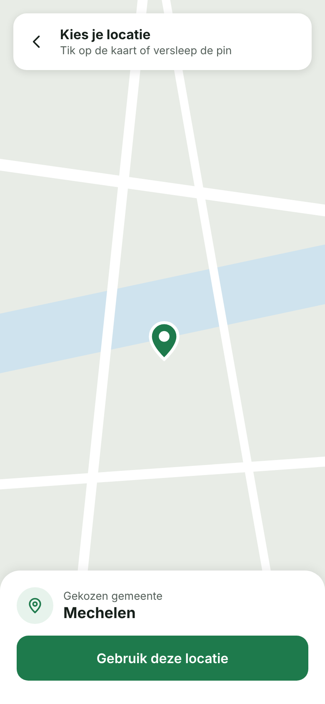</td>
  </tr>
  <tr>
    <td>Vraagt FINE en COARSE samen, pas na uitleg en een tik.</td>
    <td>Pin op de kaart. De gemeente komt van Nominatim.</td>
  </tr>
  <tr>
    <th>Definitief geweigerd</th>
    <th>Enkel benadering</th>
  </tr>
  <tr>
    <td>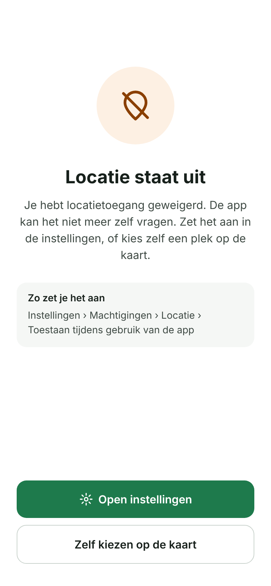</td>
    <td>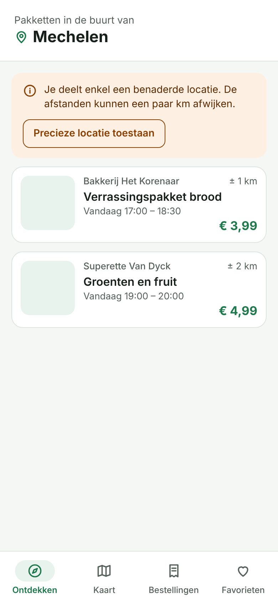</td>
  </tr>
  <tr>
    <td>Knop naar de app-instellingen.</td>
    <td>Melding dat afstanden kunnen afwijken.</td>
  </tr>
</table>

---

## Meldingen en laden

<table>
  <tr>
    <th>Lege lijst</th>
    <th>Geen internet</th>
    <th>Laden</th>
  </tr>
  <tr>
    <td>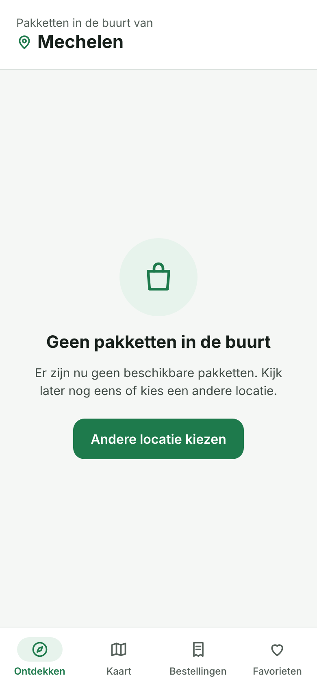</td>
    <td>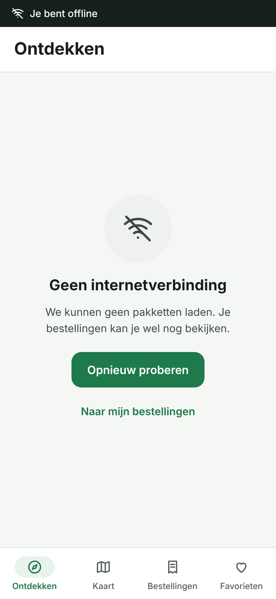</td>
    <td>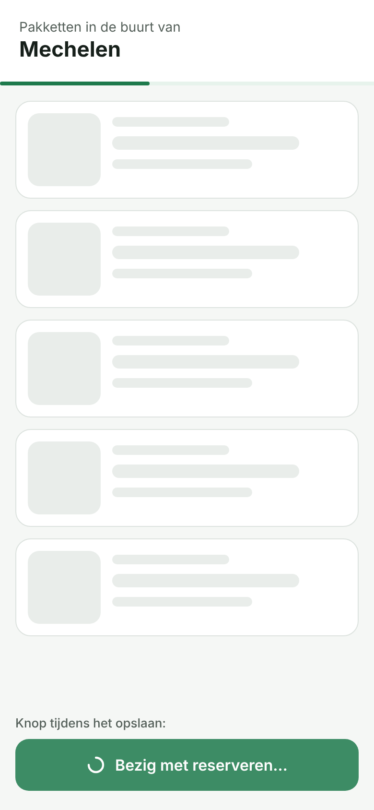</td>
  </tr>
  <tr>
    <td>G1</td>
    <td>G1 Verwijst naar Bestellingen, die offline werken.</td>
    <td>G3 Skeleton-kaarten en een knop met spinner.</td>
  </tr>
</table>

---

## Huisstijl

| Rol | Kleur |
|---|---|
| Primair | `#1E7A4C` |
| Primair donker | `#14532D` |
| Primair licht | `#E7F3EC` |
| Achtergrond | `#F5F7F5` |
| Oppervlak | `#FFFFFF` |
| Tekst | `#17201B` |
| Tekst secundair | `#56615B` |
| Waarschuwing | `#8A3F00` op `#FDF0E3` |
| Fout | `#B42318` op `#FDECEA` |
| Eigen locatie | `#2563EB` |

Lettertype: Inter. Knoppen en tikzones zijn minstens 44 px hoog.

---

## Overzicht vereisten

| Vereiste | Scherm(en) |
|---|---|
| A1 Registreren met rol | Registreren |
| A2 Inloggen, uitloggen, juist startscherm | Inloggen, Ontdekken, Mijn winkel |
| A3 Duidelijke foutmeldingen | Inloggen, Registreren |
| K1 Locatie vragen, pin bij weigering | Locatie-toestemming (4 schermen) |
| K2 "In de buurt van {gemeente}" | Ontdekken, Kaart |
| K3 Lijst gesorteerd op afstand | Ontdekken |
| K4 Kaart met markers | Kaart |
| K5 Realtime bijwerken | Ontdekken, Kaart |
| K7 Detailscherm met kleine kaart | Pakketdetail |
| K8 Reserveren met aantal | Pakketdetail |
| K9 Ophaalcode | Bestellingen |
| K10 Bestellingen, ook offline | Bestellingen, Geen internet |
| K12 Favorieten | Pakketdetail, Favorieten |
| H1 Winkel aanmaken met pin | Mijn winkel |
| H2 Adres automatisch invullen | Mijn winkel |
| H3 Pakket aanbieden | Pakket aanmaken |
| H4 Foto als Base64 | Pakket aanmaken |
| H5 Eigen pakketten met reservaties | Mijn pakketten |
| G1 Duidelijke meldingen | Lege lijst, Geen internet, formulieren |
| G2 Rotatie zonder dataverlies | In de code, geen apart scherm |
| G3 Laadindicatoren | Laden |
